# Open Control Edge

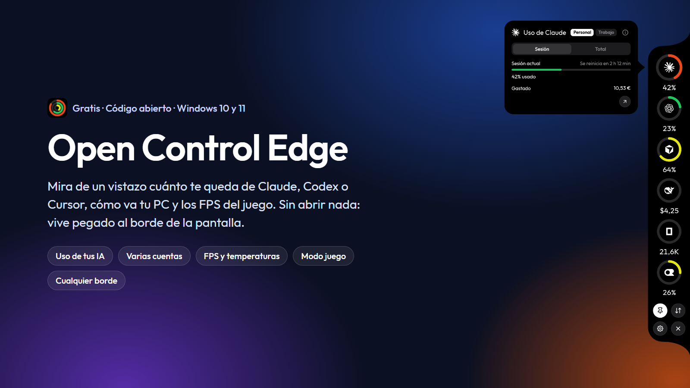

I built this because I spent all day checking how much Claude and Codex I had left, and how hot my laptop was running
while I played. Now it all lives in a column of rings stuck to the edge of the screen: hover over it and it tells you.
It's free, it's open source and it doesn't spy on you.

> *A Windows edge widget that shows your remaining Claude / Codex / Cursor quota, your CPU & GPU temperature and your
> game's FPS at a glance. The app speaks English and Spanish.*

   

## Download

### **[⬇ Download Open Control Edge](https://github.com/danielfinchdev/open-control-edge/releases/latest)**

Inside you'll find `OpenControlEdge-win-x64.zip`. To install it:

1. **Unzip it** wherever you like (your Downloads folder is fine).
2. **Open `OpenControlEdge.exe`** and say yes when Windows asks for permission. If you see "Windows protected your PC",
   click "More info" and then "Run anyway": it shows up because the program doesn't have a paid certificate yet, not
   because it does anything shady.
3. You'll see **"Checking your system…"**: it looks over your PC and sets up whatever is missing (for example, the
   driver that reads the temperature). Click **"Accept and install"** and you're done: it appears on the right edge
   (you can move it later) and starts with Windows.

From then on you don't need to come back here: when I release a new version you'll see **a red dot on the settings
button** and install it with one click. (If you're coming from 2.1.0, install it by hand this one time.)

## What it shows

- **What you have left on each AI**: Claude, Codex, Cursor, OpenCode, DeepSeek and OpenRouter. How much of the session
  and the week you've used, when it resets and, if you pay extra, how much you've spent.
- **How your PC is doing**: CPU and graphics card temperature, RAM and the **FPS** of the game in front of you.
- **Game mode**: one click closes what's running in the background for no reason, tunes the power plan so things don't
  heat up and, when you turn it off, puts everything back the way it was.
- **All your accounts, without hunting for them**: it finds your other Claude, Codex and Cursor sessions on its own,
  whatever drive they're on. Each one gets a label ("Go", "Pro Lite" or any name you like) and one click switches
  account. The (i) tells you when your subscription renews and another button opens that AI's app.
- **Wherever you want it**: right, left, top or bottom, centred or exactly where you drop it, and on the screen you
  choose if you have several.
- **Two views and a button**: one for your AIs, another for your PC, and one of your own. That way your screen doesn't
  fill up with rings.
- Make it yours: light or dark theme, colours, **background colour**, size, ring order.

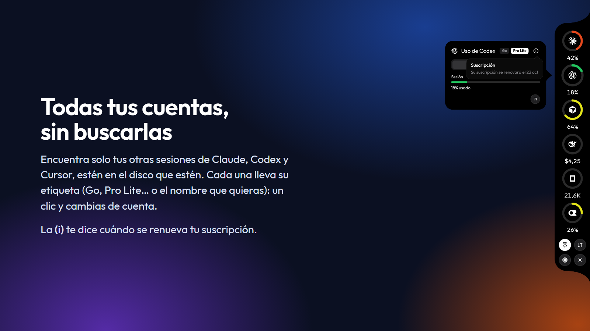

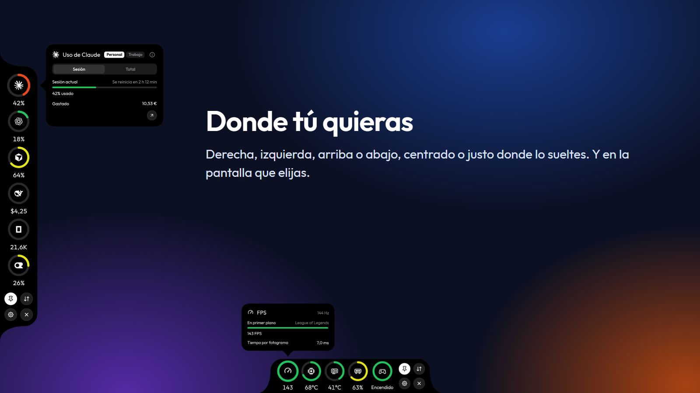

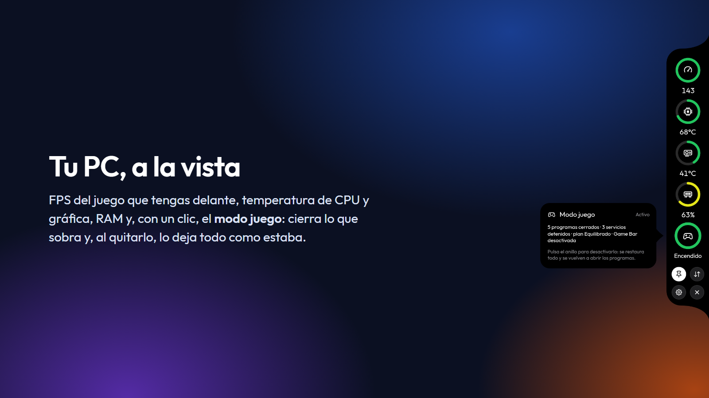

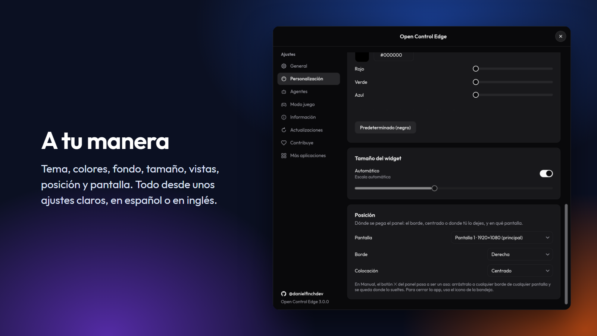

## Can I trust it?

- **Your session only goes to its own service.** It reads your Claude Code, Codex or Cursor session solely to ask
  Anthropic, OpenAI or Cursor how much you've used; it doesn't send it anywhere else and never modifies it.
- **No telemetry.** No stats, no ads, no accounts. It only talks to your AI services, to GitHub to find out whether
  there's a new version and, if you press "Send" in Contribute, to the service that forwards your message to me.
- **The code is right here**, for anyone to see. Updates are signed and the app won't install anything that doesn't
  carry that signature.

All the details, for anyone who wants them, are further down in [Privacy and security](#privacy-and-security).

## Questions, bugs or ideas?

From the app itself: **Settings › Contribute**. Write to me, add a screenshot if you like and press "Send"; you don't
need an account for anything. If you have a GitHub account, you can also open an
[issue](https://github.com/danielfinchdev/open-control-edge/issues).

---

# For the curious and for developers

Everything below is the technical detail: requirements, how it works inside, where the data comes from, security and
how to build it.

## Requirements

> [!IMPORTANT]
> **PawnIO is ESSENTIAL for reading the temperature.** LibreHardwareMonitor, the library the widget uses for its
> sensors, needs the signed **PawnIO** driver to access the CPU's low-level registers (MSR). Without it, the CPU/GPU
> rings show "Install PawnIO to see the temperature". The installation window checks for it and installs it for you;
> if you'd rather do it by hand, see the row below.

| Requirement | What for | How |
|---|---|---|
| **PawnIO** (essential) | Reading CPU temperature and load | The installation window installs it, or `winget install --id namazso.PawnIO -e`, or the official installer from [pawnio.eu](https://pawnio.eu) |
| 64-bit Windows 11, or Windows 10 version 1809 or later | Operating system | The installation window checks it |
| Administrator rights | Reading sensors and FPS (the widget starts elevated through a scheduled task) | The welcome window sets it up with a single UAC prompt |
| .NET 10 SDK | Building only | The Release build already includes the runtime |

**Checking that PawnIO is installed:** `winget list --id namazso.PawnIO` should list it. Then restart the widget: the
CPU ring should show degrees instead of the warning.

## More screenshots

| AI view | PC view | Two Codex accounts | Its subscription |
|---|---|---|---|
| 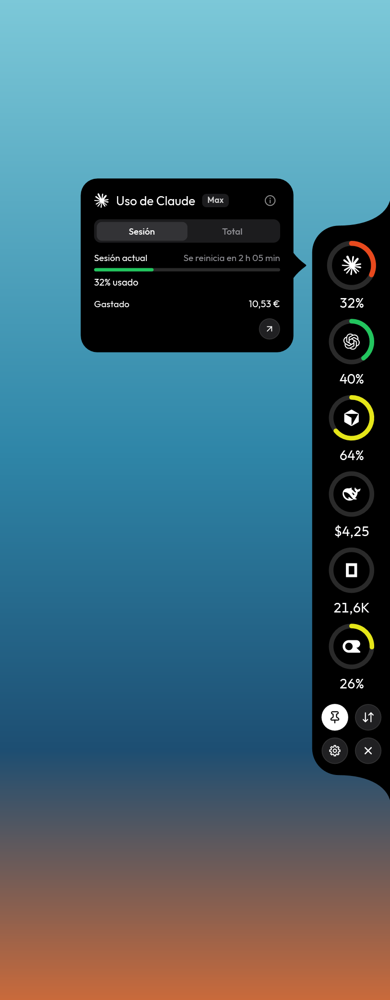 |  | 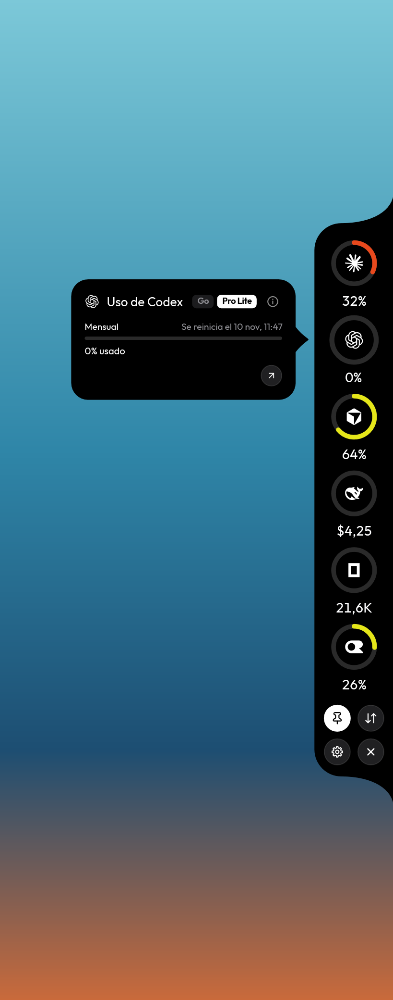 | 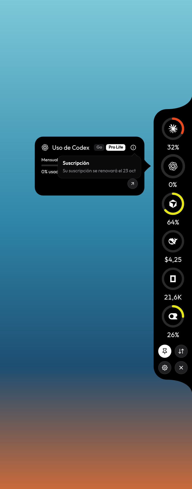 |

| Top | Bottom |
|---|---|
|  |  |

| Left | Manual | FPS | Game mode |
|---|---|---|---|
| 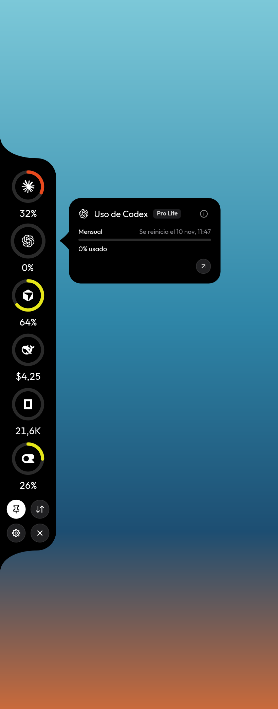 | 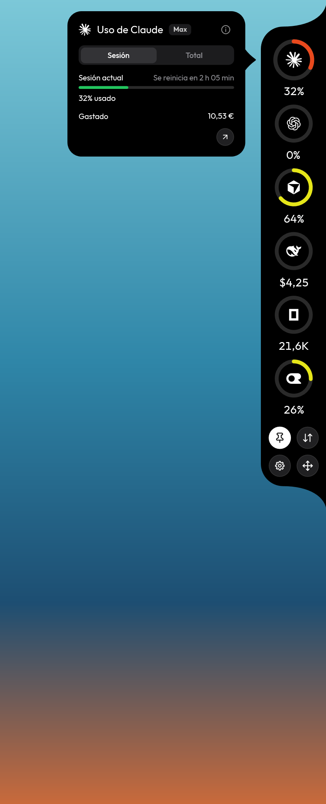 | 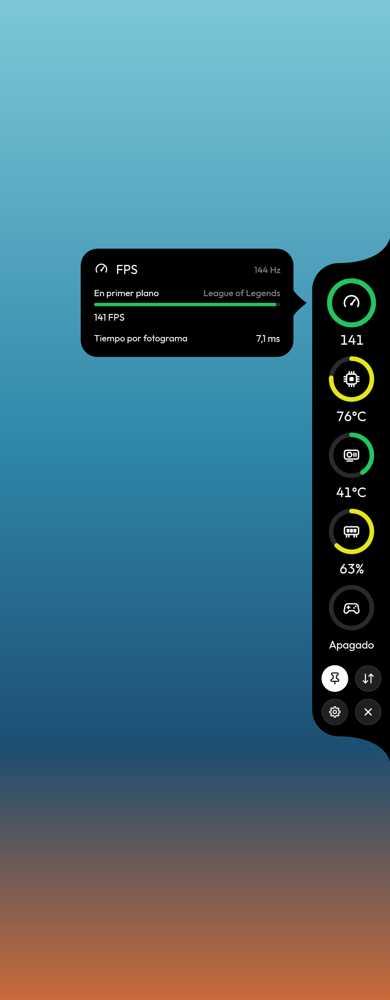 | 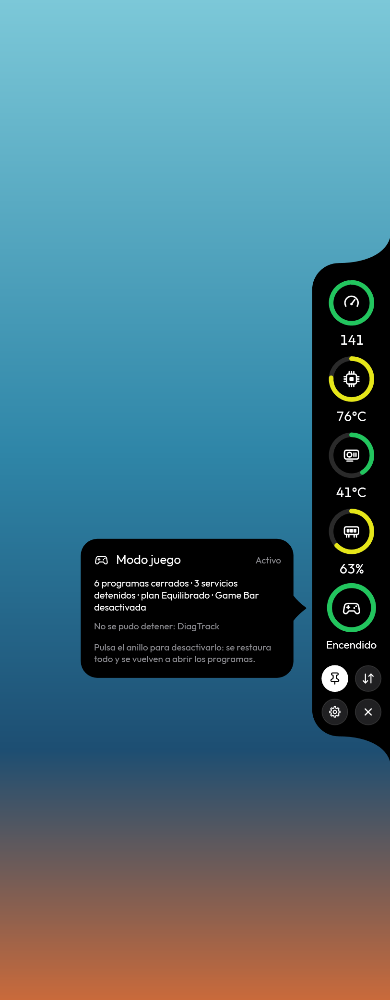 |

| Cursor | DeepSeek | Two Claude accounts | Without PawnIO |
|---|---|---|---|
| 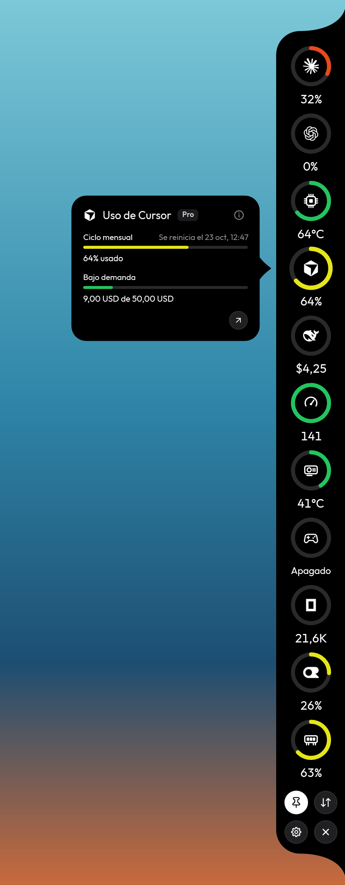 | 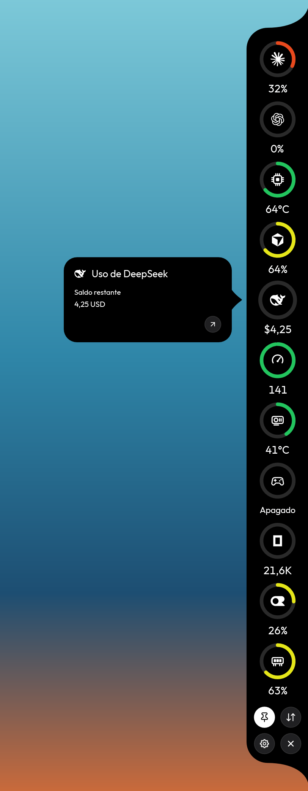 | 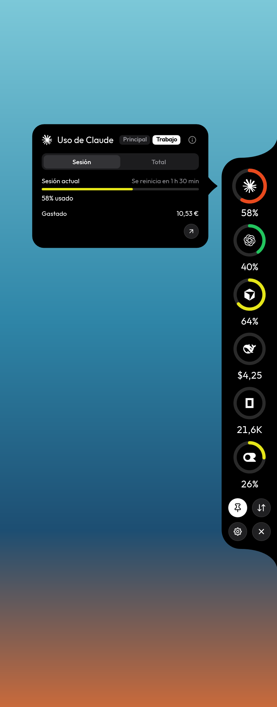 | 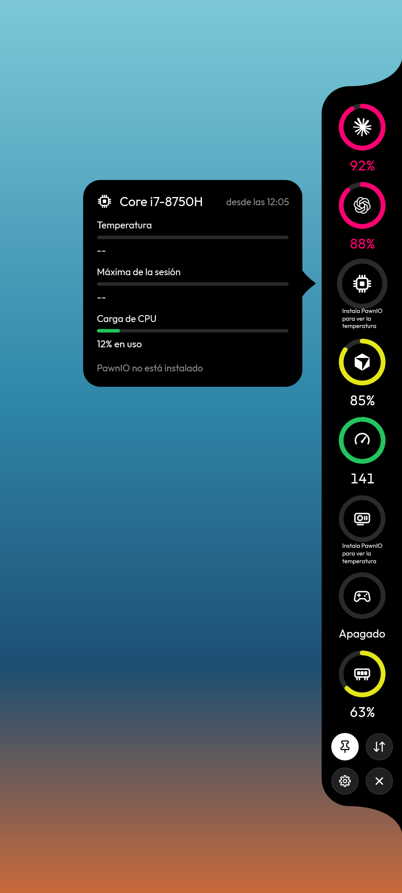 |

| Settings › Position | Settings › Accounts | More apps | Installation |
|---|---|---|---|
| 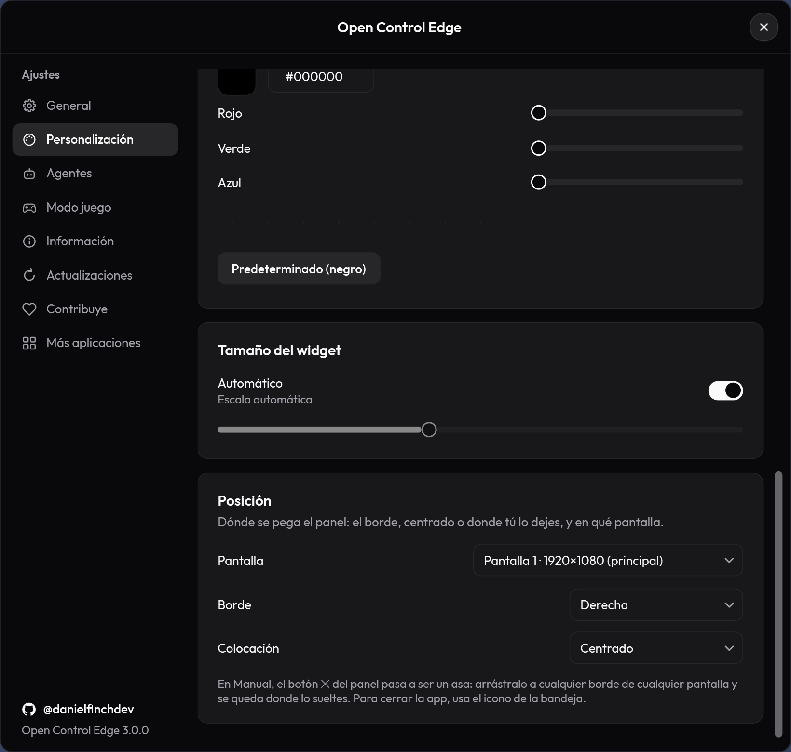 | 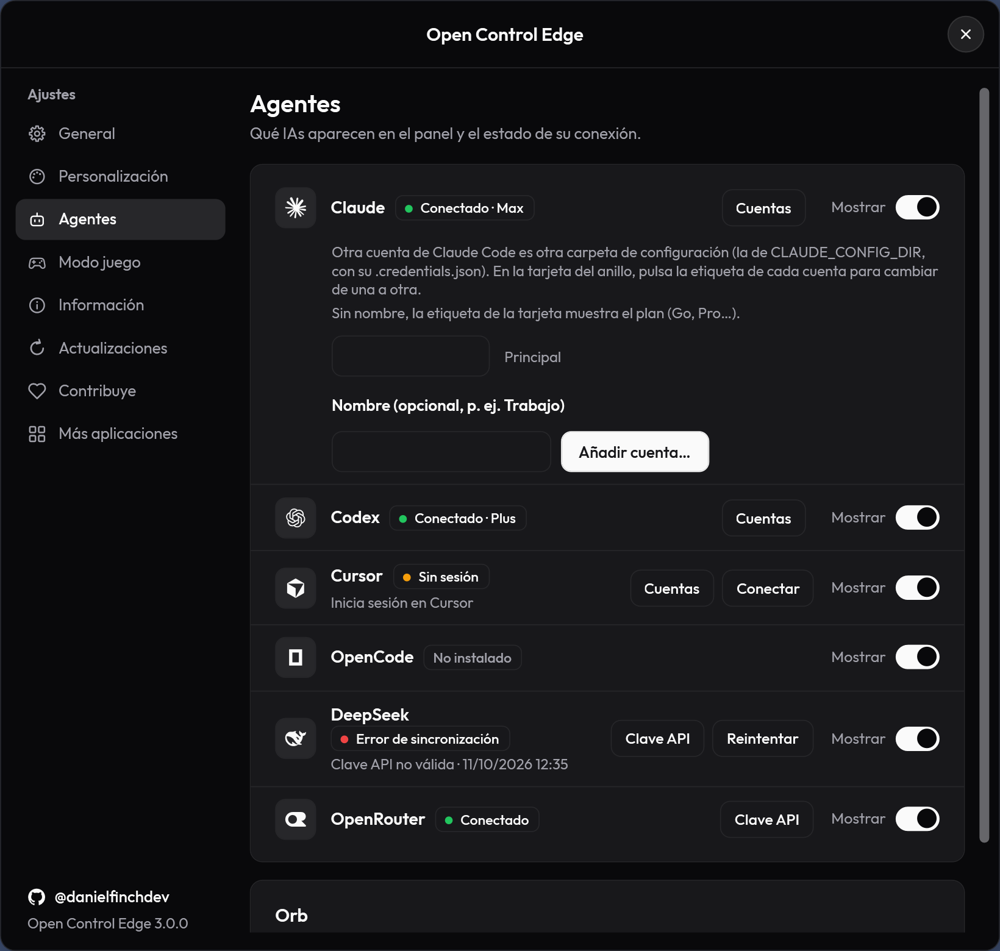 | 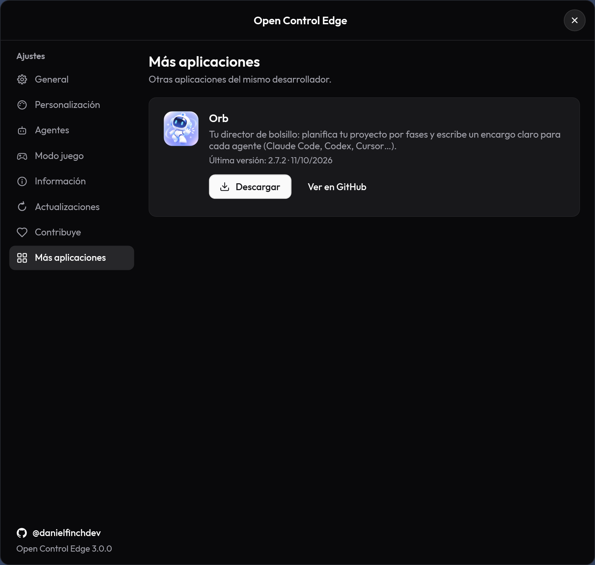 | 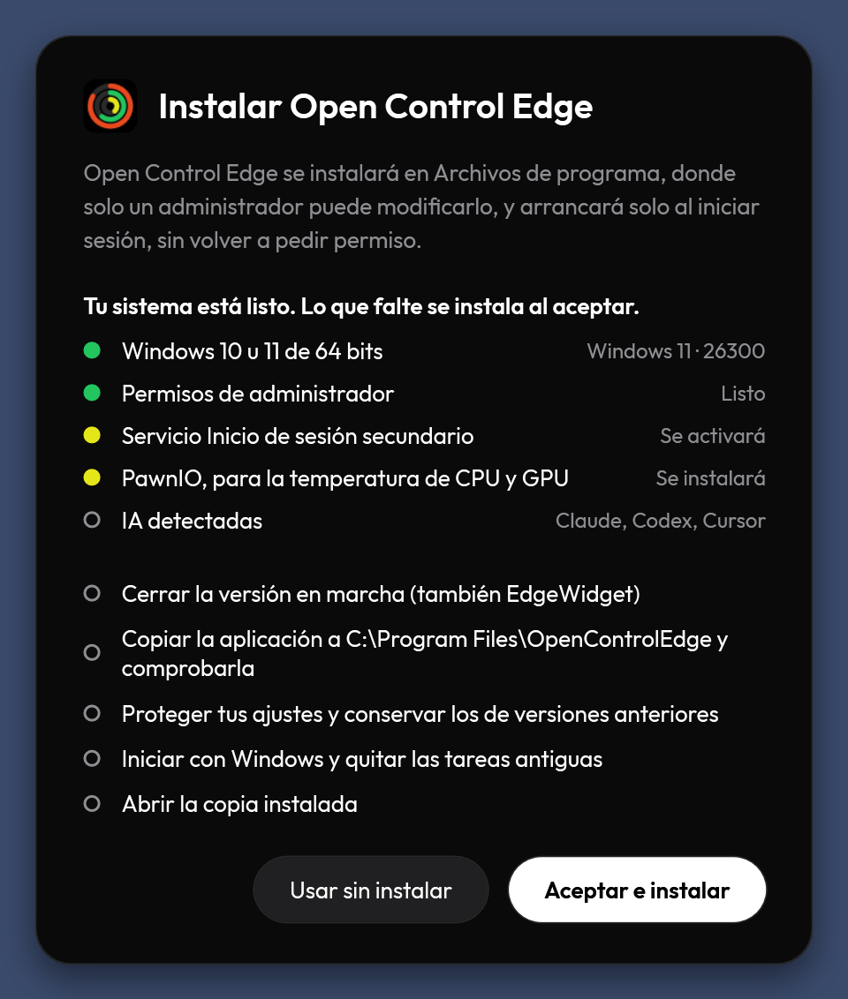 |

All of them are generated by `--snapshot` with sample data (the screenshots show the Spanish interface).

---

## What it does

A black panel docked to the edge of the screen (the right one by default; see [Position](#position)), always on top of
other windows and with no taskbar button. Each ring is a source; hovering over it unfolds a card with the details, which
slides from one ring to the next without disappearing.

| Ring | What it shows |
|---|---|
| **Claude** | % of the 5-hour session (if your account has one), weekly limit and, if you've spent usage credits, the amount in its currency (e.g. €) |
| **Codex** | % of the limit window, labelled by its length (session / daily / weekly / monthly) and, if the account has credits, the credit balance |
| **Cursor** | % of the monthly Pro cycle and, if you use on-demand billing, the amount spent in USD (and its limit) |
| **OpenCode** | Input / output / reasoning / cache tokens and accumulated local cost |
| **DeepSeek** | Remaining API balance in the currency the provider returns |
| **OpenRouter** | % used if the key has a limit; otherwise, accumulated spend in USD |
| **FPS** | FPS of the foreground program (see [FPS ring](#fps-ring)); the card shows the process, the FPS, the frame time and the monitor's Hz |
| **CPU** | Current temperature, session maximum and load |
| **GPU** | Temperature, usage and memory (NVIDIA or AMD; Intel if it has a temperature sensor) |
| **Game mode** | Switch with a gamepad icon: empty = off, filled = on (see [Game mode](#game-mode)) |
| **RAM** | % of physical memory in use; on the card, GB used / total, cached and committed |

Spend only appears when the provider's response carries a real figure greater than zero; it is never estimated.

The OpenCode ring appears if its CLI or its local data is detected; DeepSeek and OpenRouter appear once you save a key.
Claude, Codex and Cursor are detected through their clients or credentials. You can force or hide each ring in
Settings. The GPU ring is hidden when no supported graphics card is detected. The panel re-centres with an animation
when rings are shown or hidden.

### Views

The panel shows one view at a time:

- **AI** — the AI rings (Claude, Codex, Cursor, OpenCode, DeepSeek and OpenRouter).
- **PC** — FPS, CPU, GPU, RAM and Game mode (the last one, since it's a switch).
- **Custom** — any mix you like of rings from the two above. It can be turned off in Settings → Appearance; the view
  button then just toggles between AI and PC.

A round button on the panel (↓↑, "Switch view") cycles through the views (AI → PC → Custom) with a fade. In Settings →
Appearance you choose the active view and, for each view, which rings are shown and in what order
(↑↓). By default they're in alphabetical order and, in PC, the FPS ring comes first. The panel's scale is computed for
the largest view (with the rings available), so it doesn't change size when you switch. The panel background is also
chosen there (**Widget background**): preset colours, `#RRGGBB` or R/G/B sliders; black by default, and on light
backgrounds the text and rings switch to the dark variant automatically.

### Two modes

- **Pinned** — the panel always stays open.
- **Automatic** — it tucks away into a 5 px strip at the edge and unfolds when the mouse gets close.

You switch with the pin button on the panel itself, which is filled while pinned, and the choice is remembered. The four
round buttons come in pairs: pin and view at the top, settings and close at the bottom.

### Position

In Settings → Appearance → **Position** you choose:

- **Screen** — if you have several. If that screen is disconnected, the panel goes back to the primary one; it
  repositions itself when the resolution, DPI or taskbar changes.
- **Edge** — right (default), left, top or bottom. At the top and bottom the rings are laid out in a row and the card
  opens below or above.
- **Placement** — **Centred** on that edge or **Manual**: wherever you left it with the handle.

**Move and resize it from the panel itself**: hold down the ✕ button for a second (a ring fills up around it) or drag
it, and it turns into a handle (↔); take it to any edge of any screen and it stays where you drop it. While it's a
handle, the size grip (⤢) also appears next to the panel with the % beside it: drag it away or closer to make the panel
bigger or smaller (it snaps to 100 % and won't go beyond what fits; double click: automatic size). When you let go, the
ring empties over 6 seconds and the ✕ and the grip-free panel come back; it doesn't count down while you're dragging.
A normal click still quits the app.

**Edit widget** (Settings → Appearance): the ✕ becomes the handle, the gear becomes a ✓, and a grip with the size in %
appears next to the panel; drag it away or closer to make the panel bigger or smaller, smoothly (it snaps to 100 %;
double click: automatic size). The ✓, **Done** or closing Settings saves the position and size (`placement`, `offset`,
`uiScale`) and brings the ✕ back.

### "Session" / "Total" tabs

At the top of the panel, two tabs choose what each AI ring measures (the choice is remembered):

- **Session** — the short window: Claude 5 h, Codex its shortest window. If your Claude account has no 5-hour window
  (since November 2026 the API may not send it), the ring shows the weekly limit on both tabs and the card says
  "No session limit" with the weekly limit below.
- **Total** — the long window: Claude and Codex weekly (or the longest one), Cursor the monthly billing cycle.

Cursor only has the monthly cycle, so it shows the same on both; so does Codex with a single window (Go plan: monthly).
The card still shows every window.

### Plan of each account

The header of the Claude, Codex and Cursor cards carries a label with the plan (Free, Go, Plus, Pro, Max, Ultra,
Team…). On Claude, the Max 20x plan shows up as **Ultra** (its new name; it's told apart by `rateLimitTier` in the
credentials) and Max 5x as Max. A free Claude account has no session or weekly limits to measure: the card says so
("Free account: no measurable usage limits") instead of showing an error.

### Several accounts per AI

Claude, Codex and Cursor support more than one account. In Settings → Agents → Accounts you add another one by its
configuration folder and a name:

| AI | Configuration folder | Must contain |
|---|---|---|
| Claude | the `CLAUDE_CONFIG_DIR` one | `.credentials.json` |
| Codex | the `CODEX_HOME` one | `auth.json` |
| Cursor | the `--user-data-dir` one | `User\globalStorage\state.vscdb` |

There's still one ring per AI. Next to the card's title there's a label per account: the name you give it ("Personal",
"Work") or, without a name, its plan ("Go", "Pro"). The filled one is the one the ring shows; clicking another switches
account and the choice is remembered; with more than three, the labels move to a second line and the card widens as
much as needed.

**You don't need to add them.** After each start, in the background and at low priority, the widget looks for your
other Claude Code, Codex and Cursor sessions in your user folder and on every fixed drive (C:, D:…), up to six levels
deep, without following links and skipping Windows, Program Files, ProgramData, recycle bins, `node_modules` and the
like. A folder only counts if its session file is valid and belongs to you, and it recognises the same account across
several folders (Codex by its `account_id`, Claude by its `accountUuid`, Cursor by its user id; always as a SHA-256
fingerprint, never the value). The first search can take a few seconds; later ones, almost nothing. Accounts you remove
by hand are not added again, and **Search the whole PC** (Settings → Agents → Accounts) runs it on demand. The default
folders respect `CODEX_HOME` and `CLAUDE_CONFIG_DIR`.

### Subscription and "Open"

The Claude, Codex and Cursor cards (on a paid plan) have an (i) in the top-right corner: it opens a bubble with "Your
subscription will renew on …" for the account on screen (Codex: from its `id_token`; Cursor: the end of the billing
cycle; Claude: computed from the sign-up day and monthly renewal, because `GET /api/oauth/profile` doesn't give the
date). In the bottom-right corner, a round button opens that AI's app (or its website if it isn't installed), always
without administrator rights. Renewing the session with a click on the Claude ring only works for the main account.

### FPS ring

It's the first one in the PC view. It shows the FPS of the program in the foreground, counted the way PresentMon does
it: from ETW present events (Microsoft-Windows-DXGI 42 and 55, D3D9 1 and DxgKrnl with the event filter
166/168/171/184/252). Per process, the most frequent event type wins, and Electron/Chromium apps are counted through
their GPU child process. The ETW session only exists while the ring is visible, and it is sampled once per second.

It needs the elevated (installed) copy. Without elevation, or if the program presents nothing, it shows the desktop
composition FPS (`DwmGetCompositionTimingInfo`). The arc is FPS / monitor refresh rate.

### Game mode

A ring with a gamepad icon: empty = off, filled = on. **It's disabled by default**; you enable it in Settings → Game
mode, which also lets you edit what it does when turned on:

- **Programs it closes** (without saving): by default, cloud sync, Phone Link, Teams and the Xbox Game Bar helpers.
- **Services it stops**: by default `WSearch`, `SysMain` and `DiagTrack`.
- **Power plan**: Balanced (default), High performance or Leave it.
- **Turn off Xbox Game Bar captures** (`HKCU` values).
- **Open the programs again when turning it off**, as a normal user.

It never closes protected or system processes, the process of the foreground window, the widget itself or
`claude.exe`, and there's a list of services it never stops (`seclogon`, PawnIO…). The previous state is saved to
`gamemode.json`, in the data folder, before every change; it's restored when the widget quits and, if the PC was shut
down with the mode on, when it's opened again.

### Details

- **A click on the Claude ring renews the session without opening any window** (see
  [Keeping the Claude session alive](#keeping-the-claude-session-alive)).
- **A click on the CPU ring** opens Settings › System › About in Windows, without administrator privileges.
- **A click on the RAM ring frees memory** ("Free RAM"): it trims the memory of accessible processes in the interactive
  session (`EmptyWorkingSet`), without purging the *standby* list. It's disabled by default; enable it with
  `"ramCleanup": true`.
- **Shows data within 1–2 s of starting**: the last reading (percentages, dates, plans and amounts only; no secrets) is
  saved in `cache.json`, next to the settings (see [Configuration](#configuration)), and drawn as soon as it opens;
  then it refreshes.
- **Update notices**: a new version puts a red dot on the settings button (see [Installation](#installation)).
- **Tray icon** with its own menu (Refresh now / Agents & API keys… / Start with Windows / Uninstall… / Quit) and a
  tooltip on hover.
- **Temperature warning**: every spike above 90 °C is written to the log, even while the panel is tucked away. Handy if
  your laptop runs hot and you don't know when.
- **Single instance**, repositions itself when the monitor or scaling changes, and survives a restart of Windows
  Explorer.

---

## Installation

Requirements: 64-bit **Windows 11** (or Windows 10 version 1809 or later) and an administrator account matching the user
of the interactive session.

Signing: [Code signing policy](#code-signing-policy) (free code signing provided by SignPath.io, certificate by
SignPath Foundation) and, for in-app updates, the project's own signature (see [Signing](#signing)).

1. Download the application ZIP from the [latest release](../../releases/latest), or build it (see below).
   The files in Releases are published by [GitHub Actions](../../actions) from this code.
   The workflow publishes a verifiable attestation, checked with
   `gh attestation verify OpenControlEdge.exe -R danielfinchdev/open-control-edge`.
   Update checking is **on by default** (at start-up and every 6 h; turn it off in Settings → Updates). If there's a
   new version, the settings button gets a red dot and Settings shows "New version available: X.Y.Z" with a
   **Download and install** button: one click downloads, verifies and installs it, and the widget restarts. The app only accepts a ZIP that meets all of
   the following (otherwise it installs nothing):
   - its SHA-256 matches the `digest` GitHub publishes for that file;
   - it contains exactly `OpenControlEdge.exe` and its 8 native libraries: not one file more or less;
   - **if the Release carries `OpenControlEdge-win-x64.zip.sig`**: the ZIP's ECDSA P-256 signature matches the public
     key compiled into the app. The next two checks are then not needed, but the executable's version resource must
     say "Open Control Edge" and the announced version;
   - **if there's no `.sig`**: the executable has a valid Authenticode signature from SignPath Foundation (exact name)
     and its version resource says "Open Control Edge" and the announced version. SignPath Foundation signs many
     projects with that same identity, so this check also relies on the download only being able to come from this
     repository's Releases; and each library is byte for byte the one shipped with the installed version or is signed
     by its publisher (Microsoft for the WPF ones, Xamarin for the Mono.Posix ones, SignPath Foundation for those the
     Release signs).

   The attestation can be verified manually with GitHub CLI; the app does not run `gh` in the background.

   > [!NOTE]
   > **If you're coming from 2.1.0, install 2.2.0 by hand once** (steps below): 2.1.0 only accepts updates signed by
   > SignPath, and 2.2.0 is signed with the project's own key. From 2.2.0 on, it updates itself.
2. Extract the ZIP and open `OpenControlEdge.exe`. Accept the UAC prompt (the only one) and the
   **"Install Open Control Edge"** window appears. It starts with **"Checking your system…"**: 64-bit Windows 10/11,
   administrator rights, the Secondary Logon service (re-enabled if it was disabled), PawnIO (installed automatically,
   with `-install`) and which AIs are detected. If PawnIO fails, the installation carries on and the CPU ring will say
   so. When you click **Accept and install**:
   - it closes the running version (EdgeWidget too) and its tasks;
   - it copies only `OpenControlEdge.exe` and its 8 native libraries to `C:\Program Files\OpenControlEdge`. It checks
     with SHA-256 that the copied executable is identical to the one you accepted in the UAC prompt and that each
     library is exactly the one published with it (their SHA-256 hashes are compiled into the executable), before
     moving the folder into place (if anything fails, the previous copy comes back); it then verifies that no
     unprivileged user can write to the folder or the executable. The local installation doesn't require a signature:
     it installs the executable you opened yourself;
   - it protects `%ProgramData%\OpenControlEdge\<SID>` (no links or reparse points, write access for administrators
     only and a high integrity label). Settings from earlier versions are not migrated;
   - it registers start-up with Windows (Task Scheduler: when your user signs in, **with no delay**, with elevated
     privileges and normal priority) and removes the old `EdgeWidget` and "Claude - Mantener sesion" tasks. The
     `C:\Program Files\EdgeWidget` folder and your settings are kept;
   - it starts the installed copy.

   "Use without installing" and the `--portable` / `--no-elevate` options are only available if the process is already
   running unelevated; in an elevated run the window hides that option.

PawnIO can also be installed from Settings → About. The official `PawnIO_setup.exe` asset is downloaded; before opening
it, its Authenticode signature, the subject `CN=namazso.eu` and the thumbprint
`F380DCC9F706E2756A5047B832FFE719E1BC35F5` are checked. The temporary folder lives under Program Files and PowerShell
plays no part in the verification.

From the installed copy, the tray menu has **Start with Windows** (enable / disable the task) and **Uninstall…**,
which removes the task, closes the widget and marks the Program Files folder for deletion on restart. User data in
`%ProgramData%\OpenControlEdge\<SID>` is kept.

### Why does it need administrator rights?

Reading the CPU temperature requires access to the processor's MSR registers, and that can only be done with elevated
privileges; so does counting other programs' FPS with ETW. Those are the two reasons. If you'd rather not grant them,
the Debug build runs unelevated: you'll see everything except the CPU temperature and the real FPS of the foreground
program (the FPS ring then shows the desktop composition FPS).

The installed copy starts from the scheduled task and would inherit your user's environment, which any program of yours
can change. Since 3.0 the task doesn't open the program directly: it goes through `start.cmd`, in the Program Files
folder (only administrators can write there), which clears every `DOTNET_*`, `COMPlus_*`, `CORECLR_*` and `COR_*`
variable (the ones .NET reads before starting: *profilers*, diagnostic ports, dumps…) and trims `PATH` to the Windows
folders before opening the widget. On top of that it ignores `DOTNET_STARTUP_HOOKS`, doesn't search for DLLs in `PATH`
and reads session files without following links and only if they belong to your user.

---

## Configuration

`%ProgramData%\OpenControlEdge\<SID>\OpenControlEdge.settings.json` (installed copy) or
`%LOCALAPPDATA%\OpenControlEdge\OpenControlEdge.settings.json` (unelevated run).

The log sits next to the settings; the DPAPI blobs of the keys are in the `keys\` subfolder.

```json
{
  "panelMode": "auto",
  "usageView": "session",
  "autoRenewClaude": true,
  "ramCleanup": false,
  "checkUpdates": true,
  "view": "ai",
  "providers": {
    "claude": "auto",
    "codex": "auto",
    "cursor": "auto",
    "opencode": "auto",
    "deepseek": "auto",
    "openrouter": "auto"
  }
}
```

| Key | Values | What it does |
|---|---|---|
| `panelMode` | `"pinned"` \| `"auto"` | Panel mode. Written by the button itself. |
| `usageView` | `"session"` \| `"total"` | Tab of the AI rings. Written by the tabs themselves. |
| `autoRenewClaude` | `true` (default) \| `false` | Renews the Claude session in the background before it expires. |
| `ramCleanup` | `false` (default) \| `true` | Allows "Free RAM" with a click on the RAM ring. |
| `checkUpdates` | `true` (default) \| `false` | Looks for new versions at start-up and every 6 h. Replaces `autoCheckUpdates` from 2.1. |
| `view` | `"ai"` (default) \| `"pc"` \| `"custom"` | Panel view. Written by the view button itself. |
| `customView` | `true` (default) \| `false` | Whether the Custom view can be selected. |
| `edge` | `"right"` (default) \| `"left"` \| `"top"` \| `"bottom"` | Panel edge. |
| `placement` / `offset` | `"center"` (default) \| `"manual"` / `0`…`1` | Centred, or wherever you left it with the handle (`offset`: where its centre sits along the edge). |
| `monitor` | `"\\\\.\\DISPLAY2"` (optional) | The panel's screen, by its Windows name; if missing or no longer there, the primary one. |
| `dismissedAccounts` | optional list | Account folders you removed: the automatic search won't add them again. |
| `accountNames` | optional object | Name of the main `claude`, `codex` or `cursor` account, for its label. |
| `layouts` | optional object | Per view (`ai`, `pc`, `custom`): `order` (ring order) and `hidden` (the ones turned off). Written by Settings → Appearance. |
| `panelBackground` | `"#RRGGBB"` (optional) | Panel background colour; if missing, the theme's (black in the dark theme). |
| `gameMode` | optional object | Game mode: `enabled`, `processes`, `services`, `powerPlan` (`"balanced"` \| `"high"` \| `"keep"`), `disableGameBar` and `relaunch`. Written by Settings → Game mode. |
| `accounts` / `selectedAccounts` | optional objects | Additional `claude`, `codex` and `cursor` accounts (`name` and `folder`) and the one each ring shows (0 = main). Written by Settings → Agents. |
| `providers` | optional object | Visibility of each AI ring (see below). |

Each key inside `providers` (`claude`, `codex`, `cursor`, `opencode`, `deepseek`, `openrouter`) accepts:

| Value | What it does |
|---|---|
| `"auto"` | Shows the ring only if the client is installed (default). |
| `"show"` | Forces the ring even if no installation is detected (without calling the API if there's no client). |
| `"hide"` | Hides the ring even if the client is installed. |

If you leave out `providers` or a specific key, `"auto"` is used. The widget doesn't write `providers` until you edit
it yourself; changing the panel mode keeps whatever keys you already had.

---

## Where the data comes from

| Source | Origin | Credentials |
|---|---|---|
| Claude | `api.anthropic.com/api/oauth/usage` | `%USERPROFILE%\.claude\.credentials.json` |
| Codex | `chatgpt.com/backend-api/wham/usage` | `%USERPROFILE%\.codex\auth.json` |
| Cursor | `cursor.com/api/usage-summary` | `%APPDATA%\Cursor\User\globalStorage\state.vscdb` (or the additional account's) |
| OpenCode | Local SQLite database `opencode.db` | CLI or local database |
| FPS | ETW present events (PresentMon) and `DwmGetCompositionTimingInfo` | — |
| DeepSeek | `api.deepseek.com/user/balance` | DPAPI CurrentUser key |
| OpenRouter | `openrouter.ai/api/v1/key` | DPAPI CurrentUser key |
| CPU / GPU | [LibreHardwareMonitor](https://github.com/LibreHardwareMonitor/LibreHardwareMonitor) | — |

The Claude, Codex and Cursor credentials are those of the main account; each additional account uses the ones in its
folder. The Claude, Codex and Cursor endpoints are **not documented** by their providers. The parsers require the exact
shape of the response: if it changes, the ring shows an error instead of making up a number.

**Spend and credits** (shapes checked against real requests on 2026-09-29, without personal data):

- Claude: `spend.used = { amount_minor, currency, exponent }` → amount in its currency. Shown if greater than zero.
- Claude, since 2026-11-07: `"five_hour": null` and in `limits` only `weekly_all` (and `weekly_scoped`, a per-model
  limit, which isn't shown). A response with the weekly limit and no session is a valid reading; with neither, an
  error. After an HTTP 429 it doesn't ask again for 5, 10, 20 and then 30 minutes (or whatever `Retry-After` asks for,
  if longer), for any account or for the (i); Codex waits 5 minutes after a 429 and 1 after a 5xx.
- Codex (`wham/usage`): `"credits": { "has_credits": false, "unlimited": false, "overage_limit_reached": false,
  "balance": null, "approx_local_messages": null, "approx_cloud_messages": null }` on a Go account without credits.
  The balance (in credits, not money) is only shown with `has_credits: true` and a numeric `balance`.
- Cursor (`usage-summary`): amounts in **US cents** (`individualUsage.plan = { used: 1429, limit: 2000 }` against the
  $20 included in Pro). `individualUsage.onDemand = { enabled, used, limit, remaining }`: on-demand spend is shown if
  it's enabled and `used` is greater than zero.

---

## Additional providers and API keys

| AI | Source and metric | Status |
|---|---|---|
| OpenCode | Local `opencode.db` database: input/output/reasoning/cache tokens and cost | Implemented; no network |
| DeepSeek | [`GET https://api.deepseek.com/user/balance`](https://api-docs.deepseek.com/api/get-user-balance/): balance in CNY or USD | Implemented |
| Perplexity | I couldn't find an official public usage or balance API | Not implemented |
| GitHub Copilot | [GitHub billing API](https://docs.github.com/en/rest/billing/usage): credits consumed; premium requests only apply to the legacy model | Not implemented: it doesn't provide a request quota that works for every account |
| OpenRouter | [`GET https://openrouter.ai/api/v1/key`](https://openrouter.ai/docs/api/api-reference/api-keys/get-current-api-key): key usage and limit | Implemented |
| Gemini CLI | `/stats`: session statistics, not a persistent quota | Not implemented |
| Mistral | [Usage Admin API](https://docs.mistral.ai/admin/admin-api/usage-metrics): organisation usage/cost | Requires an admin key and organisation scope |
| Windsurf | Quota endpoint observed by third parties, not officially documented | Not implemented |

### Saving or deleting keys

From the widget's gear, open **Settings → Agents**. DeepSeek and OpenRouter have a protected field for their key with
**Save** and **Delete** buttons.

Keys are encrypted with Windows DPAPI in `CurrentUser` scope and stored as binary blobs in the `keys\` subfolder of the
data folder. They're never stored in the settings JSON or written to the log. They're decrypted only in memory to build
the HTTPS header.

### OpenCode local data

The detector looks for `opencode` on `PATH` or for `opencode.db` in the data directory. `OPENCODE_DB` and
`XDG_DATA_HOME` are respected; the usual Windows data locations are inspected too. The reader opens only the active
`opencode.db` database with SQLite in read-only mode and aggregates only usage columns from the `session` table; in the
installed copy this is done by an unprivileged process (see [Privacy and security](#privacy-and-security)). It doesn't
query the CLI for the data and makes no network connections.

The parser test included in `--snapshot` uses this **internal normalised** object; it doesn't represent a promised
output of `opencode stats --json`:

```json
{
  "totalTokens": {
    "input": 12345,
    "output": 6789,
    "reasoning": 321,
    "cache": { "read": 2100, "write": 55 }
  },
  "totalCost": 1.2345
}
```

The card shows the five counters and the recorded cost. If the table or any expected field is missing, it reports an
error instead of computing an approximate figure.

### Network destinations and security

Besides Claude, Codex and Cursor, the widget contacts these destinations only to update the cards:

- `https://api.deepseek.com/user/balance` (DeepSeek; requires the user's encrypted key).
- `https://openrouter.ai/api/v1/key` (OpenRouter; requires the user's encrypted key).

And these for other reasons:

- This repository's Releases on GitHub, to look for and download updates (on by default; turn it off in Settings →
  Updates).
- `https://formsubmit.co` (FormSubmit), only when you press **Send** in Settings → Contribute. It sends the message
  type, the text, the contact email if you entered one, the app version, the Windows version and any images you added
  (up to 3). FormSubmit forwards it by email to the author; their address stays behind a FormSubmit alias. Nothing is
  sent unless you press **Send**.
- `https://api.github.com/repos/danielfinchdev/orb-dev/releases/latest`, only when you open Settings → More apps (at
  most every 30 min), to show Orb's latest version.
- `https://api.github.com/repos/namazso/PawnIO.Setup/releases/latest` and its `PawnIO_setup.exe` asset, only when the
  installation window or Settings → About installs PawnIO.
- `https://api.anthropic.com/api/oauth/profile`, only when you open the (i) on the Claude card (at most every 6 h),
  with the same token as the usage request; only the status, the billing type and the subscription's start date are
  read.

OpenCode is local. Perplexity and Windsurf are not contacted. Headers and response bodies are never logged; the services
show their own error messages and have a 15-second timeout.

---

## Privacy and security

This program reads credential files. It deserves an exact explanation of what it does with them.

**What it reads, and nothing else**

- From `.credentials.json`: only `claudeAiOauth.accessToken`, `expiresAt` and `subscriptionType` (the plan).
- From `auth.json`: only `tokens.access_token` and, from the `id_token`, only the claim
  `https://api.openai.com/auth` → `chatgpt_plan_type` (the plan). The `id_token` is decoded from the file's bytes
  without turning it into a string; the rest of its claims (email, identifiers…) are skipped.
- From `state.vscdb`: only `cursorAuth/accessToken` and `cursorAuth/stripeMembershipType`; the token is materialised as
  a string because it's sent in the HTTPS cookie; the `sub` claim is read directly with `Utf8JsonReader`. The database
  is opened read-only and in defensive mode, and in the installed copy the elevated process doesn't open it (see "The
  elevated process doesn't open SQLite databases" below). Same for the OpenCode database.
- Cursor sends the session in the cookie of the HTTPS request to `cursor.com`; it never stores or logs it.

Everything else — **including refresh tokens, the rest of the `id_token` and the `account_id`** — is skipped at the JSON
reader level, without ever becoming a text string in memory (the Cursor token is the exception noted above). Files are
opened **read-only** and never written. The buffer is cleared with `Array.Clear` once reading is done.

**What it doesn't do**

- It doesn't renew tokens on its own or write the credential files. If the access token has expired, it doesn't even
  send the request. Claude's renewal is done by the Claude Code CLI itself, launched as a normal user (see below); the
  widget only reads the expiry date before and after.
- Nothing it launches inherits its administrator rights: the Claude CLI and Windows Settings are opened with the token
  of your session's Explorer (`CreateProcessWithTokenW`), after checking that it's your same account and that it isn't
  elevated. If that isn't possible, nothing is launched.
- It doesn't write secrets to the log. Only HTTP status codes and its own messages; never response bodies or headers.
  The only third-party output that gets logged is the first error line of the Claude CLI when it fails, cut to 160
  characters and with any run of 24 or more characters that looks like a key or token replaced by "…".
- It only sends HTTPS requests to the Claude, Codex, Cursor, DeepSeek and OpenRouter endpoints listed in this README, to
  this repository's Releases (updates), to GitHub for Orb's and PawnIO's latest releases when you open More apps or
  install PawnIO and, only if you press **Send** in Contribute, to FormSubmit; all of them are detailed in "Network
  destinations and security". OpenCode uses no network.
  When renewing the session, the Claude Code CLI also makes its own minimal request to Anthropic (an "ok" to Haiku).
- It has no telemetry, analytics or resident services. Update checking (at start-up and every 6 h) is on by default
  and is turned off in Settings → Updates; downloading and installing always take a click.

**The elevated process doesn't open SQLite databases**

The Cursor (`state.vscdb`) and OpenCode (`opencode.db`) databases are written by a program running as your user, so
they're treated as untrusted. The installed copy doesn't parse them with administrator rights: it starts its own
executable as a normal user (`--read-database cursor|opencode <path|auto>`, with `__COMPAT_LAYER=RunAsInvoker`, hidden,
inside a *job* that closes it and with a 20 s limit). That process opens the file read-only and in defensive mode
(`trusted_schema` off, cell checks, no memory mapping, regular files only) and writes a small JSON through a pipe. It
costs a short start-up for each Cursor or OpenCode refresh (~0.1 s of CPU and ~30 MB for less than a second) and nothing
between refreshes. Unelevated copies (Debug) read them in-process.

**The executable lives in `C:\Program Files`, on purpose**

The scheduled task starts it as administrator without a UAC prompt. If the executable lived in a folder your user can
write to, any program running under your account — without being administrator — could replace it and inherit those
rights at the next sign-in. Only an administrator can write to `C:\Program Files`. The installer verifies the
permissions and warns if they're not correct. Settings, log, keys and cache of the elevated process are only written
to a protected folder in `%ProgramData%\OpenControlEdge\<SID>`.

**What remains, stated plainly**

- The widget runs as administrator and handles OAuth tokens. That's a larger attack surface than a normal program's.
  It's mitigated by the above, not eliminated.
- LibreHardwareMonitor loads a kernel driver (PawnIO) while the widget is open. It's the standard mechanism for reading
  sensors on Windows, but it's third-party kernel code.
- Until signing is active (see [Signing](#signing)), the executable isn't signed: SmartScreen may warn you the first
  time.
- "Free RAM", as administrator, trims the memory of the processes in your session (it doesn't empty the system cache).
  It doesn't delete anyone's data, but for a few seconds programs reload from disk whatever they need; the "freed"
  memory fills up again as soon as it's used. That's why it's disabled by default.
- The executable that reads those databases is the same one as the widget, but it runs without privileges: a failure
  while parsing a tampered file stays inside that process, which doesn't inherit administrator rights. If you don't use
  Cursor or OpenCode, hide them in Settings → Agents and the widget won't open them.
- Game mode, as administrator, closes programs and stops services from the list you edit, and changes the power plan
  and `HKCU` values. Programs are closed without saving. The previous state is written to `gamemode.json` before every
  change so it can be restored, and it's disabled by default.
- In-app updates trust that only the author publishes this repository's Releases, and the project's signing key
  (`UPDATE_SIGNING_KEY`, a GitHub Actions secret): whoever got hold of it could sign a ZIP the app would install. The
  SignPath Foundation signature, still required when there's no `.sig`, identifies the signer, not the project (see
  [Installation](#installation)).

---

## Keeping the Claude session alive

The Claude Code access token lasts about 8 hours. When it expires, the ring is stuck at `--`.

What does **not** renew it: opening the Claude desktop app (it stores its session somewhere else), or
`claude auth status` (it only reports). The only thing that renews it is a real API call, which makes the CLI use the
refresh token and rewrite the file.

The widget does it by itself, with no scripts or scheduled tasks and **without opening any window**:

- **Click on the Claude ring**: the card switches to "Renewing session…", the Claude Code CLI runs once, usage is read
  again and the card shows the result ("Session renewed: valid until 6:53 PM", "Session valid until…" or a clear error,
  such as "Claude Code not found" or "Claude Code did not answer within 60 s").
- **In the background** (`"autoRenewClaude": true`, the default): when the token has less than 30 minutes left, it runs
  4 minutes before it expires, at most once every 30 minutes.
- The CLI is looked for in `%USERPROFILE%\.local\bin\claude.exe` (native installer), then in the native binary of the
  npm package (`%APPDATA%\npm\node_modules\@anthropic-ai\claude-code\bin\claude.exe`) and, failing that, `node` +
  `cli.js` from older npm packages.
- The call is as small as possible:
  `claude -p --no-session-persistence --model haiku --tools "" --strict-mcp-config ok` (no tools, no MCP servers, no
  saved conversation), with no window (`CREATE_NO_WINDOW`), inside a *job* that kills the whole thing if it goes over
  **60 s**, and **as your normal user**, never as administrator.
- Verified on Claude Code 2.1.284: the CLI only refreshes the token when it has **less than 5 minutes** left. Before
  that, the call succeeds but leaves the token as it was; that's why the card then says "Session valid until…" and the
  automatic renewal is scheduled within those 5 minutes.
- The log records the duration, the exit code, the result and, if the CLI fails, its first error line, sanitised (see
  [Privacy and security](#privacy-and-security)). **Never any token.**

---

## Building

Requirements: [.NET 10 SDK](https://dotnet.microsoft.com/download/dotnet/10.0) (`global.json` pins 10.0.401).

```powershell
git clone https://github.com/danielfinchdev/open-control-edge.git
cd open-control-edge
dotnet publish src\OpenControlEdge\OpenControlEdge.csproj -c Release -r win-x64 -o dist
.\dist\OpenControlEdge.exe
```

**Release** produces a self-contained folder (no need to have .NET installed) that the workflow ships as a ZIP; opening
its executable brings up the installation window, which copies it in full (requires administrator). The executable is
uncompressed and uses ReadyToRun: measured on 2026-09-29, it draws the first frame with data in ~0.8 s warm and ~1.5 s
the first time, with ~150 MB of memory, versus ~1.4 s / 2.2 s and ~260 MB with compression (see the CHANGELOG).
**Debug** starts without elevating or offering the installation, so you can iterate on the UI without UAC (`--welcome`
shows it).

The Build workflow only runs on `main`. Every `v*` tag runs the same `dotnet publish` in [Actions](../../actions), signs
the ZIP for updates (see [Signing](#signing)) and attaches the ZIP and its `.sig` to the [Release](../../releases):

```powershell
git tag v1.2.0
git push origin v1.2.0
```

### Reviewing the UI without running the widget

```powershell
.\src\OpenControlEdge\bin\Debug\net10.0-windows\win-x64\OpenControlEdge.exe --snapshot C:\temp\screenshots
```

It renders **258 PNGs** with both modes, the four edges and manual placement, the three views, the tabs, the cards
(RAM, FPS and Game mode included), the Claude renewal states, Claude / Codex / Cursor spend, several accounts, error and
no-data states, a free Claude account, hidden rings, the PawnIO requirement, themes, languages, scales, the
subscription bubble, the account labels, the tray menu, the keys dialog and the installation window (welcome, system
check, progress, done, error and uninstall), and the Settings window at several screen sizes. It includes tests of
Codex credits and Cursor on-demand spend with the real shapes observed, of the account search (with test folders that
are deleted at the end), and a test OpenCode database read with the real service (deleted at the end). It doesn't read
credentials, touch the settings, open the sensors or write to the log.

---

## Signing

The Release workflow is ready to sign `OpenControlEdge.exe` with **[SignPath Foundation](https://signpath.org/)**, free
for open source projects: it uploads the published folder as an artifact, submits the signing request, waits for it to
finish, checks the Authenticode signature and attaches the ZIP with the signed executable to the Release. Until the
SignPath details exist, the step is skipped with a warning and the Release executable ships without an Authenticode
signature (the ZIP does carry the project's own signature, see
[Own signature for updates](#own-signature-for-updates)).

Steps to enable it (taken by the repository owner):

1. Apply for the project at [signpath.org/foundation](https://signpath.org/foundation) (open source project form).
   They require a public repository, an OSI license (MIT qualifies), releases built on GitHub Actions and a published
   signing policy (next section).
2. Once approved, in SignPath: install the SignPath GitHub app on the repository, create the project (for example
   `open-control-edge`) with a GitHub *trusted build system* and an **artifact configuration** that signs the executable
   inside the artifact's ZIP, only if its version resource carries the project name and the tag's version (the workflow
   passes it as the `version` parameter and checks that it matches the csproj):
   ```xml
   <artifact-configuration xmlns="http://signpath.io/artifact-configuration/v1">
     <parameters>
       <parameter name="version" />
     </parameters>
     <zip-file>
       <pe-file path="OpenControlEdge.exe" product-name="Open Control Edge" product-version="${version}">
         <authenticode-sign />
       </pe-file>
     </zip-file>
   </artifact-configuration>
   ```
   and a signing policy (for example `release-signing`) with manual approval.
3. In GitHub → *Settings* → *Secrets and variables* → *Actions*:
   - the `SIGNPATH_API_TOKEN` secret (API token of a SignPath user with submit permission);
   - the `SIGNPATH_ORGANIZATION_ID`, `SIGNPATH_PROJECT_SLUG` and `SIGNPATH_SIGNING_POLICY_SLUG` variables.
4. Push a `v*` tag: the workflow will request the signature and wait for it to be approved in SignPath.

Only the executable is signed: SignPath Foundation doesn't sign third-party components. The WPF and Mono.Posix
libraries already come signed by their publisher; `e_sqlite3.dll` (SQLite) doesn't. With the SignPath signature as the
only guarantee, an update that changes `e_sqlite3.dll` (when SQLitePCLRaw is updated) is rejected by the app and has to
be installed once from its ZIP; the project's own signature below avoids that case.

### Own signature for updates

While SignPath isn't approved (the application is still pending), and as its own path afterwards, the Release workflow
signs the whole ZIP with the project's ECDSA P-256 key and publishes the result as `OpenControlEdge-win-x64.zip.sig`
(Base64 of the IEEE P1363 signature over SHA-256). The private key is the GitHub Actions secret `UPDATE_SIGNING_KEY`
(PKCS#8 PEM); the public key is compiled into the app. If the secret is missing, the workflow warns and the Release ships
without a `.sig`.

When updating, the app installs a ZIP whose signature matches that public key: the signature covers every file, so the
Authenticode signature and the per-DLL checks are no longer needed. The SHA-256 published by GitHub, the closed list of
files and the executable's version resource saying "Open Control Edge" and the announced version are still required.
If the `.sig` doesn't match, or the Release doesn't carry one, the update is rejected.

## Code signing policy

Free code signing provided by [SignPath.io](https://about.signpath.io/), certificate by
[SignPath Foundation](https://signpath.org/).

- Committers and reviewers: [danielfinchdev](https://github.com/danielfinchdev)
- Approvers: [danielfinchdev](https://github.com/danielfinchdev)

Every release is built from this repository by GitHub Actions (`.github/workflows/release.yml`); only builds of tagged
commits are submitted for signing, and each signing request is approved manually by an approver.

**Privacy:** this program will not transfer any information to other networked systems unless specifically requested
by the user or the person installing or operating it. It only sends HTTPS requests to the usage endpoints of the AI
services the user is signed in to or has added an API key for (listed in "Where the data comes from"), carrying the
user's own credentials; it has no telemetry. It also checks this repository's GitHub Releases for updates at start-up
and every 6 hours (on by default, can be turned off in Settings; installing an update always takes a click), PawnIO is
downloaded from its official release only when the user asks for it or accepts the installation window's system check,
and feedback is sent to FormSubmit (formsubmit.co) only when the user presses "Send" in Settings → Contribute.

---

## Contributing

Contributions come in as *pull requests* against `main` and are reviewed by the maintainer before merging (see
[Code signing policy](#code-signing-policy)). Commit messages are in English and follow
[Conventional Commits](https://www.conventionalcommits.org/): `type(scope): subject`, imperative and lowercase. Before
submitting a change, check that `dotnet build -c Release` finishes with no warnings or errors.

---

## How it's built

**C# 14 / .NET 10 / WPF.** No UI frameworks, no MVVM, no dependency injection: one window, a handful of hand-drawn
controls and direct calls to the Windows API.

```
src/OpenControlEdge/
├─ Services/     Credential reading, usage APIs, sensors, settings, log, database reader, Game mode and FPS
├─ Ui/           Ring, bar, icons, palette, formatting
├─ Views/        Edge window, tray menu, snapshot renderer
└─ Interop/      user32 / shell32: tray, position, click-through; tokens, processes, memory and security
```

Some decisions that may not be obvious:

- **A single window** holds the strip, the panel and the card. That way the card can slide from one ring to another
  with render animations instead of moving system windows.
- **Hover is detected by polling the cursor position**, not with events: when the panel is tucked away the window is
  click-through (`WS_EX_TRANSPARENT`) and gets no mouse input at all.
- **That polling runs at two speeds.** Each pass starts with a cheap check; fast polling only kicks in over the
  interactive areas of the panel, strip or card, and at rest it goes fully to sleep (the mouse itself wakes it up). The
  measured cost is in the [CHANGELOG](CHANGELOG.md) (2.1.0).
- **Sensors depend on whether the panel is visible**: every 20 s with the panel pinned and visible, every 60 s
  otherwise. They never stop completely, so that "Session maximum" is a real figure and not just the moments you were
  looking. AI usage is queried at the interval chosen in Settings (2 minutes by default).
- **Rings and bars are `FrameworkElement`s with `OnRender`**, not control templates. A smaller visual tree and exact
  control over the stroke.
- **Icons are vector paths in code** in a 24×24 space, parsed as WPF geometry; there are no icon fonts or SVG files.
- **The tray icon uses `Shell_NotifyIcon` directly**, without WinForms, with the UIPI filters needed for an elevated
  process to receive clicks from a medium-integrity Explorer.

---

## License

[MIT](LICENSE). Use it, change it and publish it however you like.

---

## Credits

Sensors: [LibreHardwareMonitor](https://github.com/LibreHardwareMonitor/LibreHardwareMonitor) (MPL-2.0).

Typeface: [Outfit](https://github.com/Outfitio/Outfit-Fonts) (weights 400, 500 and 600), embedded in the executable
(SIL Open Font License 1.1, see [`OFL.txt`](src/OpenControlEdge/Assets/Fonts/OFL.txt)).

Icons: the AI provider logos are vector paths from [Lobe Icons](https://github.com/lobehub/lobe-icons)
(`@lobehub/icons-static-svg`, MIT), the interface icons come from [Lucide](https://lucide.dev) (ISC) and the GitHub mark
from [Simple Icons](https://simpleicons.org) (CC0); see [`THIRD-PARTY-NOTICES.txt`](THIRD-PARTY-NOTICES.txt). The logos
and names belong to their owners and are used only to identify each service. Open Control Edge is not affiliated with
or endorsed by Anthropic, OpenAI, Anysphere, DeepSeek, OpenRouter or OpenCode.

# Feedback

Bugs and ideas, from Settings → Contribute, in two ways:

- **Send**: needs no account at all. The message reaches the author by email through
  [FormSubmit](https://formsubmit.co) (their address stays behind a FormSubmit alias), with up to 3 screenshots (PNG or
  JPEG up to 5 MB: **Capture screen** takes a picture of the primary screen and **Add image…** picks a file) and an
  optional contact email if you'd like a reply. The type, the text, that email (if you enter it), the app version, the
  Windows version and the images are sent, and only when you press **Send**.
- **Open on GitHub**: opens a pre-filled public issue, with your GitHub account, and copies the first screenshot to the
  clipboard so you can paste it. Review and edit the text before submitting it.

Don't include personal data, yours or anyone else's, in the text or the screenshots.
